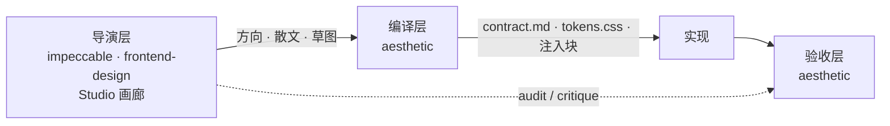
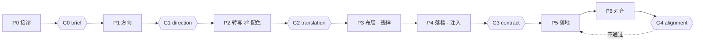

# aesthetic

把**设计方向**编译成 token 与可执行合同，注入项目设计文档，并在实现后做视觉对齐验收。

不是组件库，不是 CSS 框架，**也不是品味权威**。定气质、定创意方向是导演层的活；这个 skill 只保证那些决定变成**可执行、可校验、可长期延续**的东西。

---

## 四条硬约束

1. **先问要不要起工作台；起了就给完整 URL 并等用户确认真的打开，再问别的。** 不接受或打不开就走纯 CLI 形态（表格 + ASCII 线框），不得默认启动服务，不得在用户拒绝后偷偷启动，也不得把 URL 只写进日志或文件。
2. **合同未落成，不写第一行 UI 代码。**
3. **对齐报告未通过，不宣布完成。** "有条件通过"不算通过。
4. **真相不放在别人的文件里。** 唯一可编辑源是自己的 `decisions.json`；目标 `DESIGN.md` 只放幂等 marker 块。

---

## 三层分工



| 层 | 谁 | 产出 |
|---|---|---|
| 导演层 | `impeccable` / `frontend-design` / 自带画廊 | 气质、风格、文案语气、创意方向 |
| 编译层 | 本 skill | token 表、非协商项取值、注入块、合同 |
| 验收层 | 本 skill | L1 token / L2 几何 / L3 知觉 |

两个导演都不在时，本 skill 自导：10 张逻辑风格卡 + 3 个玻璃变体。

---

## 六阶段 + 五处闸门



| 闸门 | 通过标准 | 回退到 |
|---|---|---|
| **G0** | 用户确认业务对象 / 受众 / 品牌约束，以及 **agent 提案后用户拍板**的主页面 | P0 |
| **G1** | 用户确认方向；导演层产物已读入 | P1 |
| **G2** | 用户逐项确认七维转写表 | P2.1 |
| **G3** | 自检全绿 + `check-consistency` 通过 | P4 |
| **G4** | `status: pass`（不是 conditional） | P5 |

---

## 快速开始

```bash
# 1. 生成产物（decisions.json → tokens.* + contract.md）
node scripts/build.mjs --project /path/to/your-app

# 2. 注入非协商项到 DESIGN.md 的 marker 块
node scripts/inject.mjs --project /path/to/your-app

# 3. G3 门禁：所有派生物的 sourceHash 必须一致
node scripts/check-consistency.mjs --project /path/to/your-app

# 4. 静态 lint
node scripts/check-tokens.mjs --project /path/to/your-app

# 5. 打开工作台（调色 + 转写表 + 组件实验室）
node scripts/studio.mjs --project /path/to/your-app --open
# 脚本会打印带一次性 token 的 URL；把它贴到对话里，等用户确认打开再往下
```

跑通见 `assets/examples/minimal-operate/`。

---

## 交付物

```
<项目>/
├── DESIGN.md                  # 导演层的文件；只写 marker 块
└── design/aesthetic/
    ├── decisions.json         # ★ 唯一可编辑事实源
    ├── contract.md            # 十段合同（派生）
    ├── tokens.css             # 令牌（派生）
    ├── tokens.json            # 机读（派生）
    ├── alignment-report.md    # 对齐报告
    └── shots/approved-*.png
```

唯一生成链，单向：

```
decisions.json → tokens.json / tokens.css → contract.md → 注入块
```

每个派生物带 `sourceHash`；任一派生物过期，G3 失败。

---

## 非协商项

| # | 规则 | 要点 |
|---|---|---|
| R1 | 视觉对齐 | 结构值对齐 8pt；光学值走独立 token |
| R2 | 微对比色阶 | **ΔL = \|L₁−L₂\| ∈ [0.010, 0.030]**，L 通道绝对差 |
| R3 | 禁用纯黑 | 正文 `#1A1A19`；阴影/玻璃暗线里的带 alpha 黑豁免 |
| R4 | 输入框咬合 | 外投影 + inset 内环 + 内投影；内环是"变深"不是高光 |
| R5 | 暗色字重降一档 | body / strong / display 各降一格；正文 ≥300 |
| R6 | AI 界面 | 30ms 错峰模糊对焦；图标 `-0.125em`；思考框 `0fr→1fr` |
| R7 | 计时器等宽 | `font-variant-numeric: tabular-nums` |
| R8 | 设置页 | 左名右控件；无外层卡片；删除独立成组 |
| R9 | 表单页 | 标签在上；输入区全宽 |

规则分 MUST / SHOULD / ADVISORY。用户可覆盖任何一条，但必须登记 override（九字段）。

完整规格见 `references/rules/`。

---

## 目录

```
aesthetic/
├── SKILL.md                # 执行手册（agent 入口）
├── SKILL-DESIGN.md         # 设计依据（给维护者）
├── README.md               # 你正在读的
├── references/
│   ├── directors.md        # 导演层接入
│   ├── translation.md      # 散文 → 数字
│   ├── injection.md        # 注入块
│   ├── rules/              # R1–R9 全文
│   └── styles/             # 10 张风格卡（自导模式）
├── schemas/                # decisions / tokens JSON Schema
├── scripts/                # build·inject·check·shoot·audit·studio
├── assets/
│   ├── studio/             # 工作台 UI + fixture
│   ├── templates/          # contract / 注入块 / 对齐报告模板
│   ├── examples/           # 端到端样例
│   ├── recipes/            # 组件片段（只读模板）
│   └── vendor/             # hyalite（MIT）
└── tests/run.mjs           # 34 项自测，零依赖
```

---

## 自测

```bash
node tests/run.mjs
```

覆盖：OKLCH 数学、JSON Schema、决策哈希、marker 幂等、生成链、lint、路径越界防护。

---

## 浏览器与依赖

- **核心零运行时依赖**：`node:http` + 原生 ESM，不引入 Vite/Next
- 截图与审计走可选适配器（CDP Proxy / 项目已有的 Playwright）；**不可用时输出 `manual-required`，绝不伪造通过**
- 最低浏览器：Chromium 111+ / Safari 16.4+ / Firefox 113+

---

## 已知限制

- `backdrop-filter: url(#svg)` **只有 Chromium 真渲染**（Safari WebKit bug 245510、Firefox bug 1787623）。液态玻璃必须写三级降级链。
- `CSS.supports('backdrop-filter','url(#x)')` 在三大引擎都返回 true，不能做特性检测。
- 目标 `DESIGN.md` 若属于 `impeccable`，它的 `document` 会重生成该文件，注入块会消失——这是预期行为，重跑 `inject.mjs` 即可。

---

## 许可

本 skill 原创部分见 `LICENSE`。`assets/vendor/hyalite.js` 为 MIT，许可全文与 SBOM 在同目录。
