# aesthetic

把**设计方向**编译成 token 与可执行合同，注入项目设计文档，并在实现后做视觉对齐验收。

不是组件库，不是 CSS 框架，**也不是品味权威**。定气质、定创意方向是导演层的活；这个 skill 只保证那些决定变成**可执行、可校验、可长期延续**的东西。

---

## 安装

```bash
# 装到当前项目（写进 .claude/skills/，随仓库一起走）
npx skills add mogenga/aesthetic --skill aesthetic

# 或全局安装，所有项目可用
npx skills add mogenga/aesthetic --skill aesthetic -g
```

也可以直接克隆到 `~/.claude/skills/aesthetic/`。技能名是 `aesthetic`（由 `SKILL.md` 的 frontmatter 决定），装完重启会话即可用。目录页：<https://www.skills.sh/mogenga/aesthetic>。

---

## 风格预览

10 张逻辑风格卡 / 12 个 CSS 变体。同一套内容、同一套结构，只换变体 CSS——所以差别全部来自风格本身，不来自页面内容。

|  |  |
|---|---|
| 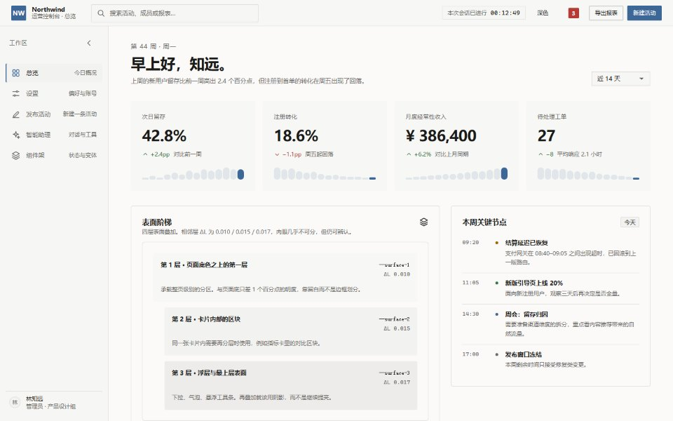 | 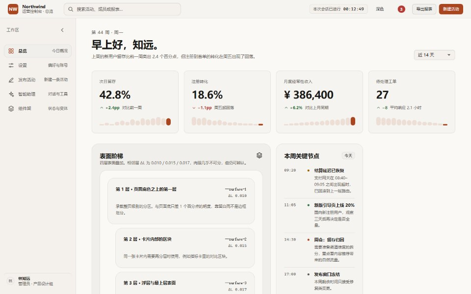 |
| **极简主义**<br>用留白与字级建立秩序，只有一条发丝线 | **便当盒**<br>用尺寸不同的格子讲内容优先级 |
| 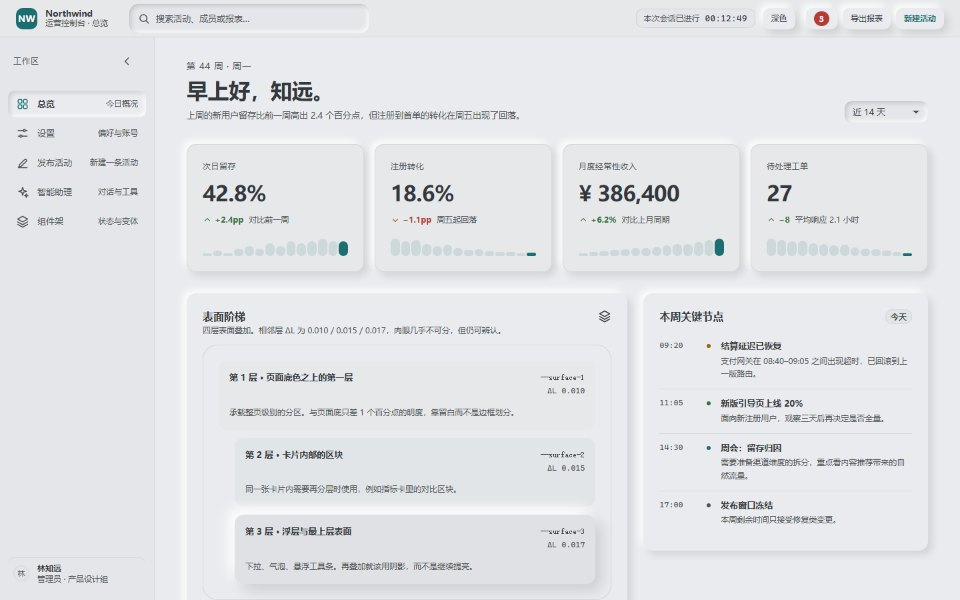 | 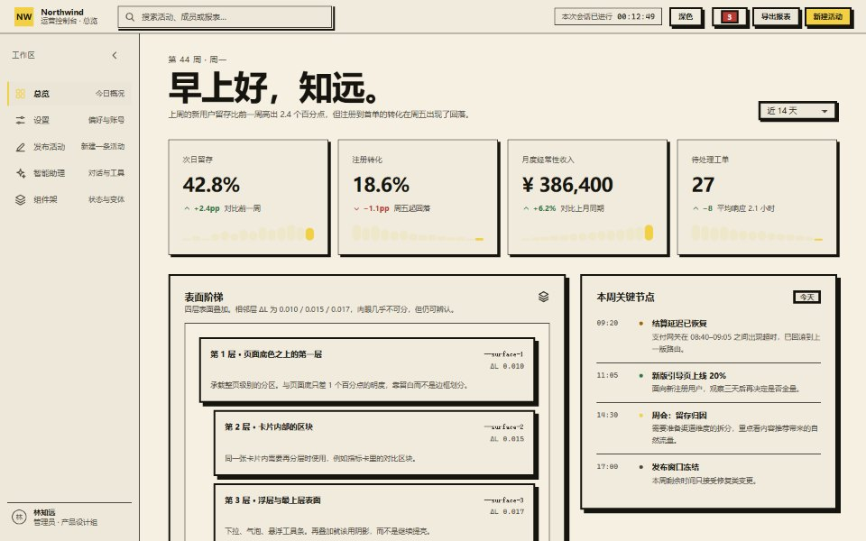 |
| **新拟态**<br>明暗双阴影把控件挤进或挤出表面 | **新粗野主义**<br>零圆角、厚描边、无模糊硬阴影、撞色 |
| 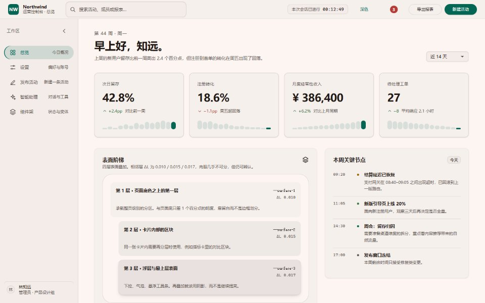 | 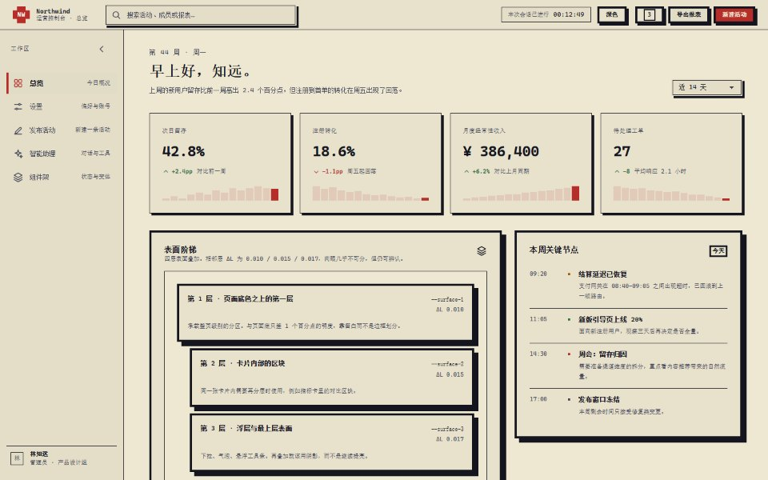 |
| **材料设计**<br>三档高度语义 + 状态层 + 大圆角 | **像素风**<br>8px 网格、硬边、无抗锯齿 |
| 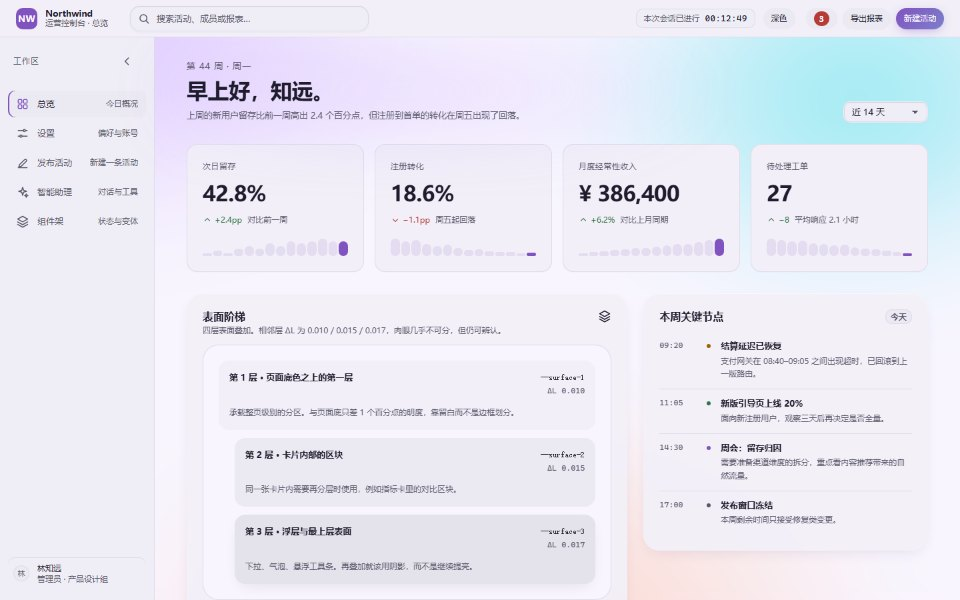 | 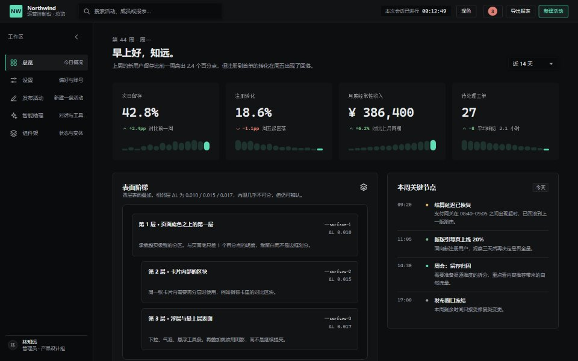 |
| **渐变 · 弥散光**<br>大色斑做氛围底，表面半透 | **黑色科技极简**<br>近黑底、极细同宽线、单点高光 |
| 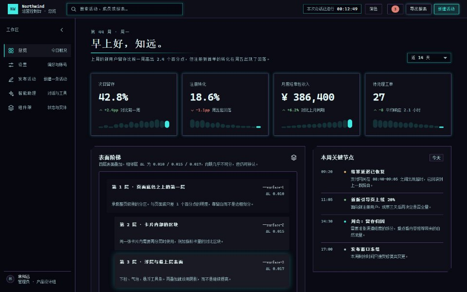 |  |
| **赛博朋克**<br>品红霓虹、扫描线、切角、等宽字 | **透明玻璃**<br>不模糊，只染色，靠亮边立形 |
|  | 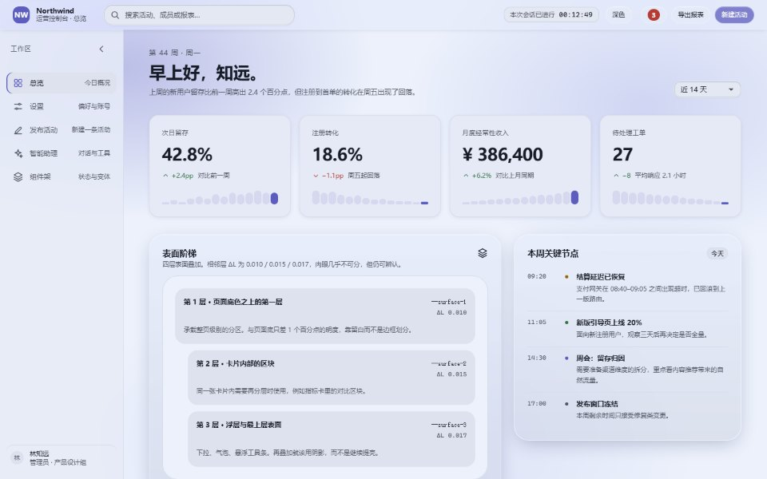 |
| **毛玻璃**<br>背景被糊掉，边缘靠双 inset 伪造厚度 | **液态玻璃**<br>边缘折射并弯曲背后的内容（仅 Chromium 真渲染） |

每张卡在 `references/styles/*.md` 里有签名特征、代价与适用场景。完整清单见 `assets/studio/styles/style-index.json`（渲染时唯一计数源）。

除了组件外观，12 个变体在**字族、字号阶梯、侧栏宽度、统计卡排布**上也各不相同——换风格不是换一层皮肤。`dark-tech` 是暗色专属（索引里标 `"theme": "dark-only"`），不产出白色版本。

每张卡还带 **3 套适配该风格的配色方案**（玻璃 4 套）。每套同时定义强调色和中性色的色相 / 染色浓度，换方案时整页冷暖都会变，而不只是按钮颜色。方案数据在 `assets/studio/styles/palettes.json`。

---

## 四条硬约束

1. **先问要不要起工作台；起了就给完整 URL 并等用户确认真的打开，再问别的。** 不接受或打不开就走纯 CLI 形态（表格 + ASCII 线框），不得默认启动服务，不得在用户拒绝后偷偷启动，也不得把 URL 只写进日志或文件。
2. **合同未落成，不写第一行 UI 代码。**
3. **对齐报告未通过，不宣布完成。** "有条件通过"不算通过。
4. **真相不放在别人的文件里。** 唯一可编辑源是自己的 `decisions.json`；目标 `DESIGN.md` 只放幂等 marker 块。

---

## 三层分工

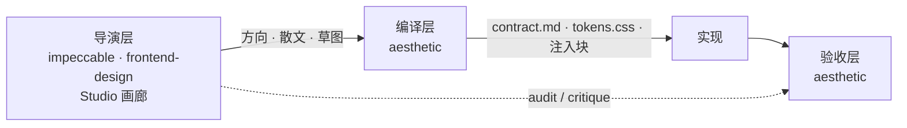

| 层 | 谁 | 产出 |
|---|---|---|
| 导演层 | `impeccable` / `frontend-design` / 自带画廊 | 气质、风格、文案语气、创意方向 |
| 编译层 | 本 skill | token 表、非协商项取值、注入块、合同 |
| 验收层 | 本 skill | L1 token / L2 几何 / L3 知觉 |

两个导演都不在时，本 skill 自导：上面那 10 张卡 / 12 个变体。

---

## 六阶段 + 五处闸门

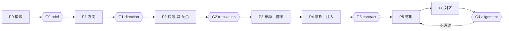

| 闸门 | 通过标准 | 回退到 |
|---|---|---|
| **G0** | 用户确认业务对象 / 受众 / 品牌约束，以及 **agent 提案后用户拍板**的主页面 | P0 |
| **G1** | 用户确认方向；导演层产物已读入 | P1 |
| **G2** | 用户逐项确认七项设计参数（每项注明出自哪句话） | P2.1 |
| **G3** | 自检全绿 + `check-consistency` 通过 | P4 |
| **G4** | `status: pass`（不是 conditional） | P5 |

---

## 工作台

`scripts/studio.mjs` 起一个本地服务，三个模式：

| 模式 | 做什么 |
|---|---|
| **画廊** | 12 个变体并排等比缩略，可放大看整页；选中即换掉预览的样式与配色基线 |
| **调色** | 先选**预设配色方案**（每张卡 3 套，玻璃 4 套），再进高级微调：色相环 + C×L 平面、吸管、hex/rgb/hsl/oklch 四格式、中性色浓度。七项设计参数全部控件驱动，每项配真实值渲染的样本 |
| **组件实验室** | 在**当前项目的 token + 当前风格**下看组件真实渲染；可把某一屏的计算样式固化成 CSS 片段写进项目 |

默认路径是「选方案 → 微调」，不是「从色相环开始」：多数人只需要在一组成品配色里挑一个。预置的方案卡会显示该方案的页面底 / 强调色 / 正文三个色点，点进去看到的就是整页效果。

零依赖、原生 ESM、无构建。所有写回端点都要求一次性 token，且只监听 `127.0.0.1`。

---

## 快速开始

```bash
# 0. 动手前先录基线（链接、字段、表单、事件处理器、选择器）
node scripts/baseline.mjs --project /path/to/your-app --record

# 1. 生成产物（decisions.json → tokens.* + contract.md）
node scripts/build.mjs --project /path/to/your-app

# 2. 注入非协商项到 DESIGN.md 的 marker 块
node scripts/inject.mjs --project /path/to/your-app

# 3. G3 门禁：所有派生物的 sourceHash 必须一致
node scripts/check-consistency.mjs --project /path/to/your-app

# 4. 静态 lint
node scripts/check-tokens.mjs --project /path/to/your-app

# 5. 打开工作台（调色 + 转写表 + 组件实验室）
node scripts/studio.mjs --project /path/to/your-app --open
# 脚本会打印带一次性 token 的 URL；把它贴到对话里，等用户确认打开再往下

# 6. 改完对回基线：hard 项（链接 / 字段 / 表单 / 处理器 / id / 选择器）丢失即失败
node scripts/baseline.mjs --project /path/to/your-app --check
```

基线的 hard 项是源码里作者已经写下的接线；重设计只该换样子，不该把它们弄丢。soft 项（标题、图片、字数）只告警。豁免写在代码注释里，理由不足 12 字无效。

跑通见 `assets/examples/minimal-operate/`。

---

## 交付物

```
<项目>/
├── DESIGN.md                  # 导演层的文件；只写 marker 块
└── design/aesthetic/
    ├── decisions.json         # ★ 唯一可编辑事实源
    ├── contract.md            # 十段合同（派生）
    ├── tokens.css             # 令牌（派生）
    ├── tokens.json            # 机读（派生）
    ├── baseline.json          # 重设计前的「不许丢东西」基线
    ├── alignment-report.md    # 对齐报告
    └── shots/approved-*.png
```

唯一生成链，单向：

```
decisions.json → tokens.json / tokens.css → contract.md → 注入块
```

每个派生物带 `sourceHash`；任一派生物过期，G3 失败。

项目做不做暗色是显式决定：`meta.theme` 为 `light` 时 `color` 段只有 `light`，合同里也不会出现暗色段落；写 `light-dark` 才产出两套。

---

## 非协商项

| # | 规则 | 要点 |
|---|---|---|
| R1 | 视觉对齐 | 结构值对齐 8pt；光学值走独立 token |
| R2 | 微对比色阶 | **ΔL = \|L₁−L₂\| ∈ [0.010, 0.030]**，L 通道绝对差 |
| R3 | 禁用纯黑 | 正文 `#1A1A19`；阴影/玻璃暗线里的带 alpha 黑豁免 |
| R4 | 输入框咬合 | 外投影 + inset 内环 + 内投影；内环是"变深"不是高光 |
| R5 | 暗色字重降一档 | body / strong / display 各降一格；正文 ≥300 |
| R6 | AI 界面 | 30ms 错峰模糊对焦；图标 `-0.125em`；思考框 `0fr→1fr` |
| R7 | 计时器等宽 | `font-variant-numeric: tabular-nums` |
| R8 | 设置页 | 左名右控件；无外层卡片；删除独立成组 |
| R9 | 表单页 | 标签在上；输入区全宽 |

规则分 **MUST / SHOULD / ADVISORY**，另有一条与强度无关的 **REFLEX** 轴——它管的不是「这样做对不对」，而是「这是不是模型想都没想就会做的默认手」（替用户做决定、把发出当收到、不知道就编、专家控件摆主路径……）。命中 REFLEX 不需要 override，但要在对齐报告里登记为什么这次判断优先于惯性，清单见 `references/reflex.md`。

用户可覆盖任何一条，但必须登记 override（十字段缺一不可，含脚本能重算的 `guard`）。`reason` 写「设计需要」这类套话会被拒；`guard` 写成 `contrast: fg/bg >= 4.5` 这样的断言，由 `check-tokens.mjs` 重新推导，不达标报 `OV1`–`OV4`。

完整规格见 `references/rules/`。

---

## 目录

```
aesthetic/
├── SKILL.md                # 执行手册（agent 入口）
├── README.md               # 你正在读的
├── references/
│   ├── phrasing.md         # 内部术语 → 对用户白话的对照表
│   ├── directors.md        # 导演层接入
│   ├── translation.md      # 散文 → 数字
│   ├── injection.md        # 注入块
│   ├── layout-patterns.md  # 页型线框
│   ├── motion.md           # 动效语汇
│   ├── reflex.md           # 模型的默认手清单（X1–X9）
│   ├── rules/              # R1–R9 全文
│   └── styles/             # 10 张风格卡（自导模式）
├── schemas/                # decisions / tokens JSON Schema
├── scripts/                # build·inject·check·shoot·audit·studio·baseline
├── assets/
│   ├── studio/             # 工作台 UI + 夹具 + 12 个变体 CSS + 配色方案
│   ├── readme/             # README 用的风格预览图
│   ├── templates/          # contract / 注入块 / 对齐报告模板
│   ├── examples/           # 端到端样例
│   ├── recipes/            # 组件片段（只读模板）
│   └── vendor/             # hyalite（MIT）
└── tests/                  # run / css-check / baseline，零依赖
```

---

## 自测

```bash
node tests/run.mjs        # 56 项：OKLCH 数学、Schema、哈希、marker 幂等、生成链、lint、guard 复算、路径越界
node tests/css-check.mjs  # 12 个变体的结构检查 + 双索引交叉校验
node tests/baseline.mjs   # 19 项：基线录制、hard 丢失、软项告警、豁免语法
```

---

## 浏览器与依赖

- **核心零运行时依赖**：`node:http` + 原生 ESM，不引入 Vite/Next
- 截图与审计走可选适配器（CDP Proxy / 项目已有的 Playwright）；**不可用时输出 `manual-required`，绝不伪造通过**
- 最低浏览器：Chromium 111+ / Safari 16.4+ / Firefox 113+

---

## 已知限制

- `backdrop-filter: url(#svg)` **只有 Chromium 真渲染**（Safari WebKit bug 245510、Firefox bug 1787623）。液态玻璃必须写三级降级链。
- `CSS.supports('backdrop-filter','url(#x)')` 在三大引擎都返回 true，不能做特性检测。
- 目标 `DESIGN.md` 若属于 `impeccable`，它的 `document` 会重生成该文件，注入块会消失——这是预期行为，重跑 `inject.mjs` 即可。
- **项目级**单主题深色暂不支持：Schema 要求 `color.light` 必填，`commit` 端点与 `check-tokens` 都会拒绝。项目只有「单主题 · 浅」与「浅 + 深」两种。
  （**变体级**暗色专属是支持的：`dark-tech` 在索引里标 `"theme": "dark-only"`，只有一套深色 token，Studio 会锁住浅色预览。）

---

## 许可

本 skill 原创部分见 `LICENSE`。`assets/vendor/hyalite.js` 为 MIT，许可全文与 SBOM 在同目录。
